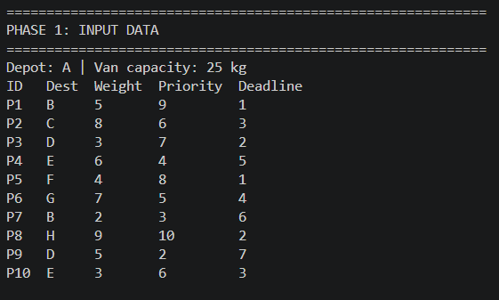
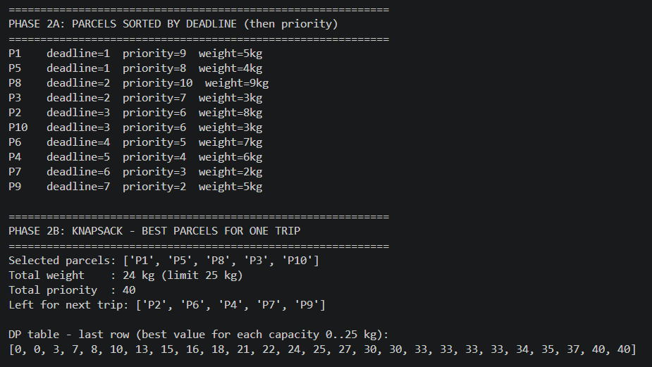
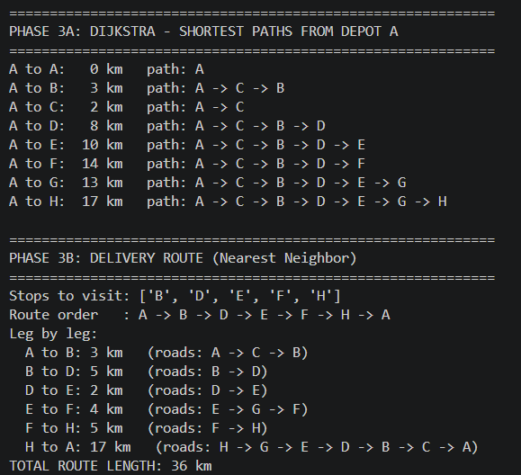
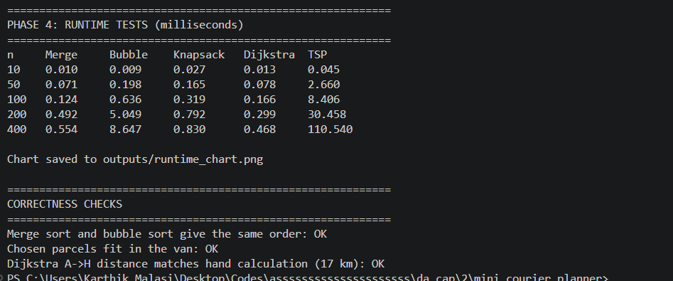
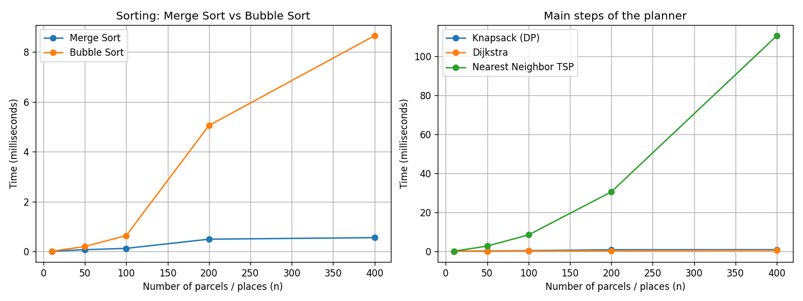

# Mini-Courier Planner
**Course:** Design & Analysis of Algorithms (ETCCDA302) | **Capstone Assignment**

A beginner-friendly Python prototype that takes a list of parcels and a city map, then produces
(1) a sorted parcel list, (2) the best set of parcels for one van trip, and (3) a delivery route.

## How to run
1. Install Python 3.8+ and matplotlib: `pip install matplotlib`
2. Open a terminal in this folder.
3. Run: `python courier_planner.py`
4. The output prints on screen; the chart is saved to `outputs/runtime_chart.png`.

The screenshots below are of this exact program's output (full text in `outputs/sample_output.txt`).

## Files
| File | Purpose |
|---|---|
| `courier_planner.py` | The whole program (commented, one function per algorithm) |
| `data/parcels.csv` | Sample parcels (id, destination, weight, priority, deadline) |
| `data/graph.csv` | Sample city roads (from, to, distance in km) |
| `outputs/sample_output.txt` | Output trace of a full run (use as screenshot evidence) |
| `outputs/runtime_chart.png` | Runtime chart |
| `screenshots/` | Screenshots of each phase's output (used in this README) |

---

## Phase 1: Design and Planning

**Problem:** A courier van starts at depot **A**, can carry **25 kg**, and must deliver parcels
to places on a map. Not every parcel fits in one trip, so we must choose wisely and then drive the shortest sensible route.

**Data design**
- **Parcel:** `id, destination, weight_kg, priority (1-10, higher = more important), deadline_days`
- **Map (graph):** places are nodes, roads are weighted edges stored as an adjacency list, e.g. `graph["A"] = {"B": 4, "C": 2}`.

**How the algorithms work together**

```
parcels.csv ──► Merge Sort ──► 0/1 Knapsack (DP) ──► stops list ──┐
(by deadline)   (what to carry)                                    ├──► Nearest-Neighbor route
graph.csv ─────────────────► Dijkstra (shortest paths) ───────────┘    (in what order to deliver)
```

| Step | Algorithm | Why chosen | Time complexity |
|---|---|---|---|
| Prioritise | Merge Sort | Always O(n log n), stable | O(n log n) |
| Pick parcels | 0/1 Knapsack (DP) | Each parcel is taken whole or not at all | O(n × W) |
| Shortest paths | Dijkstra (min-heap) | Road lengths are positive | O((V+E) log V) |
| Route order | Nearest Neighbor | Fast approximation for TSP (exact TSP is too slow) | O(k²) for k stops |

**Screenshot: input data (parcels and van capacity)**



## Phase 2: Package Prioritisation and Box Filling

**Sorting:** parcels are ordered by earliest deadline; ties are broken by higher priority.
Result: `P1, P5, P8, P3, P2, P10, P6, P4, P7, P9`.

**Knapsack:** `table[i][w]` = best total priority using the first `i` parcels with `w` kg of space.
For each parcel we either skip it (`table[i-1][w]`) or take it (`table[i-1][w-weight] + priority`) and keep the better one.
We then walk back through the table to find which parcels were taken.

- **Selected:** P1, P5, P8, P3, P10
- **Weight:** 24 kg of 25 kg | **Total priority:** 40
- **Left for the next trip:** P2, P6, P4, P7, P9

**Screenshot: sorted parcels, selected parcels and DP table**



## Phase 3: Route Maker and Graph Processing

**Dijkstra from depot A** gives the shortest distance to every place (e.g. A→H = 17 km via A-C-B-D-E-G-H).
Dijkstra is also run from each delivery stop so we know the shortest distance between any two stops.

**Nearest neighbor:** stops are B, D, E, F, H. From the current place we always go to the closest unvisited stop.

`A → B → D → E → F → H → A`

| Leg | Distance |
|---|---|
| A → B | 3 km |
| B → D | 5 km |
| D → E | 2 km |
| E → F | 4 km |
| F → H | 5 km |
| H → A | 17 km |
| **Total** | **36 km** |

**Screenshot: Dijkstra shortest paths and final route**



## Phase 4: Performance Testing and Optimisation

Random datasets of n = 10, 50, 100, 200, 400 parcels/places were generated (fixed random seed, so results repeat).
Times are in milliseconds and will differ slightly on each computer.

| n | Merge | Bubble | Knapsack | Dijkstra | Nearest-Neighbor TSP |
|---|---|---|---|---|---|
| 10 | 0.009 | 0.007 | 0.019 | 0.012 | 0.044 |
| 50 | 0.044 | 0.098 | 0.079 | 0.043 | 1.340 |
| 100 | 0.102 | 0.396 | 0.185 | 0.115 | 5.757 |
| 200 | 0.229 | 1.596 | 0.307 | 0.172 | 23.685 |
| 400 | 0.485 | 6.542 | 0.691 | 0.391 | 97.346 |

**Screenshot: runtime table and correctness checks**





**Observations**
- Bubble sort (O(n²)) grows much faster than merge sort (O(n log n)); at n = 400 it is about 14× slower. This is why merge sort is used.
- Knapsack and Dijkstra grow slowly and stay fast.
- The route step (nearest-neighbor) is the slowest, because it runs Dijkstra once from **every** stop.

**Correctness checks (built into the program):** merge sort and bubble sort give identical order; the chosen parcels fit within 25 kg; Dijkstra A→H matches the hand calculation (17 km).

**Ideas for future optimisation**
1. Run Dijkstra only from stops that are actually used, or cache results between trips.
2. Improve the route with 2-opt, which fixes crossings in the nearest-neighbor route.
3. Use the weight-and-value knapsack with a 1-D table to cut memory from O(n × W) to O(W).
4. Repeat the plan for the leftover parcels to create trip 2, trip 3, and so on.

## Phase 5: Result Explanation

For the sample data, the planner decides that the van takes the five most valuable parcels that fit (P1, P5, P8, P3, P10),
visits their destinations B, D, E, F, H in the order A → B → D → E → F → H → A, and drives 36 km in total.
Nearest neighbor is an approximation, so the route is good but not guaranteed to be the very shortest possible.

**Limitations:** roads are assumed two-way and the same in both directions; one van; one trip; no traffic or time windows.

*Everything above can be reproduced by running `python courier_planner.py`.*
